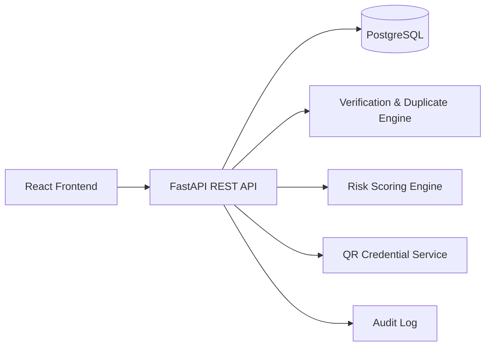

# VeriScholar — AI-Powered Student Admission Verification and College Compliance Monitoring

VeriScholar is a full-stack MVP for synthetic student-admission verification and compliance monitoring. It helps authorized stakeholders identify potential duplicates, intake-limit breaches, and high-risk records with explainable scoring and auditability.

## Problem Statement
Institutions need faster, explainable, and privacy-aware admission checks. VeriScholar centralizes records, flags potential anomalies, and supports human review workflows.

## Key Features
- JWT authentication with role-based authorization (Student, College Admin, Regulatory Admin)
- Student record CRUD, filters, pagination, CSV upload validation
- Duplicate detection and explainable verification statuses
- Approved-intake compliance monitoring using distinct eligible admissions
- Rule-based explainable risk scoring (0–100, Low/Medium/High/Critical)
- Investigation case management with status transitions and notes
- Append-only audit events for sensitive operations
- Privacy-preserving QR credential prototype (signed payload, expiry, revocation, rate-limited public verification)
- Synthetic data seeding (safe to rerun)

## Tech Stack
- Frontend: React + Vite + TypeScript + Tailwind + Recharts + Axios
- Backend: FastAPI + SQLAlchemy + Pydantic + Alembic + PostgreSQL
- Testing: Pytest (backend), Vitest (frontend scaffold)
- DevOps: Docker Compose

## Architecture (Mermaid)


## Database Overview
Core entities: users, institutions, courses, approved_intakes, student_records, verification_results, risk_assessments, investigation_cases, case_history, audit_events, qr_credentials.

## Project Structure
- `frontend/`
- `backend/app/api`, `backend/app/core`, `backend/app/models`, `backend/app/schemas`, `backend/app/services`, `backend/app/tests`
- `backend/alembic/`
- `backend/scripts/`
- `docker-compose.yml`

## Local Setup (Linux/Windows with Docker)
1. Copy env:
   - `cp .env.example .env`
2. Start stack:
   - `docker compose up --build`
3. API docs:
   - `http://localhost:8000/docs`
4. Frontend:
   - `http://localhost:5173`

## Local Setup (without Docker)
### Backend
```bash
cd backend
python -m venv .venv
source .venv/bin/activate  # Windows: .venv\Scripts\activate
pip install -r requirements.txt
uvicorn app.main:app --reload
```

### Migrations
```bash
cd backend
alembic upgrade head
```

### Seed Synthetic Data
```bash
cd backend
python -m app.scripts.seed
```

## API Highlights
- `POST /api/v1/auth/login`, `GET /api/v1/auth/me`
- `GET/POST/PATCH/DELETE /api/v1/students`, `POST /api/v1/students/upload-csv`
- `POST /api/v1/institutions`, `POST /api/v1/institutions/approved-intakes`, `GET /api/v1/institutions/compliance`
- `GET /api/v1/analytics/dashboard`
- `GET/POST/PATCH /api/v1/cases`
- `GET /api/v1/audit`
- `POST /api/v1/qr/create`, `GET /api/v1/qr/verify/{credential_ref}`, `POST /api/v1/qr/revoke/{credential_ref}`

## Sample Demo Logins (Synthetic)
- Regulatory Admin: `reg.admin@verischolar.demo` / `Demo@123`
- College Admin: `college.admin@verischolar.demo` / `Demo@123`
- Student: `student@verischolar.demo` / `Demo@123`

## Testing
```bash
cd backend
pytest -q
```

## Security & Privacy Notes
- Passwords hashed with bcrypt
- JWT-based authentication with expiry
- Role enforcement on backend endpoints
- Rate limiting for login and public QR verification
- CSV file type checks and server-side validation
- Demo credentials are VeriScholar-issued prototypes (not official APAAR credentials)
- Never store or expose full sensitive identifiers in logs or public verification

## Synthetic Data Disclaimer
All institutions, students, identifiers, and cases in this MVP are fictional synthetic data for demonstration.

## Limitations
- APAAR verification is simulated through a documented adapter-style status flow
- In-memory rate limiting is suitable for MVP/demo; production should use distributed stores
- The frontend focuses on core workflows and can be expanded with more role-specific UX

## Future Enhancements
- External authorized verification integration
- Advanced anomaly detection model pipeline
- Background jobs for large CSV imports
- Rich report exports and advanced filters

## Hackathon Demo Workflow
1. Login as regulatory admin
2. Review dashboard metrics
3. Inspect students and compliance summary
4. Review investigation cases and audit logs
5. Generate and verify demo QR credential
